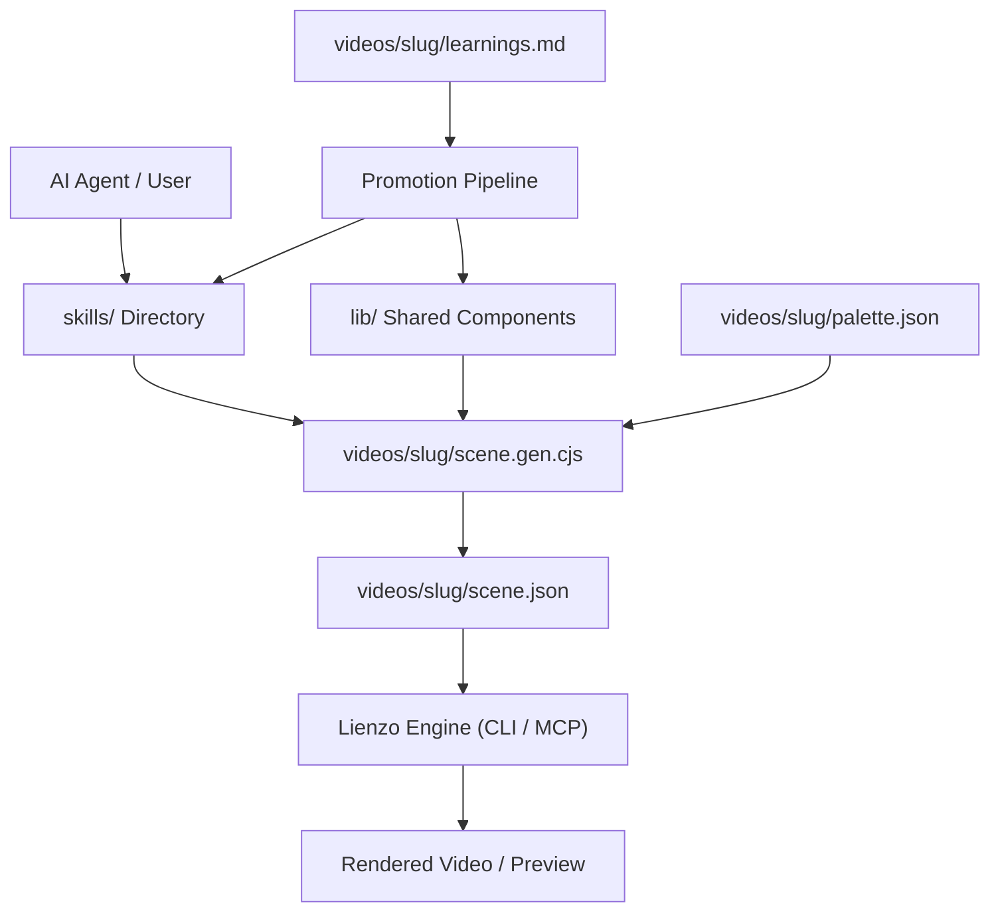

# Architecture Blueprint

This document defines the system topology, directory layout, layer boundaries, and structural patterns for Animator. AI agents must consult this document before modifying system structure or introducing new components.

---

## 🏛️ System Overview & Boundaries

### 1. Overview
Animator is a hybrid architecture composed of agent skills (`skills/`), a shared generator library (`lib/`), and self-contained video artifacts (`videos/<slug>/`). The system interacts with Lienzo as an external tool/engine: generators write compact scene JSON without depending on a running Lienzo runtime.

### 2. Tech Stack & Dependencies
- **Runtime & Language:** Node 24+, CommonJS (`.cjs`). Zero external runtime dependencies.
- **Package Manager:** pnpm.
- **Engine / CLI:** Lienzo (`pnpm lienzo` CLI and Lienzo MCP tools).
- **Testing:** Node.js built-in test runner (`node --test`).

### 3. Layer Boundaries & Directory Map
```text
animator/
├── skills/                     # Global knowledge & agent skills
│   ├── lienzo-research/        # Factual research for videos
│   ├── lienzo-storyboard/      # Narrative, beats, and craft rules
│   ├── lienzo-art-direction/   # Visual style, palette, and review
│   └── lienzo-animate/         # Scene generator assembly
├── lib/                        # Shared, palette-agnostic generator pieces
├── videos/                     # Self-contained video workspaces
│   └── <slug>/                 # Single video folder
│       ├── brief.md            # Video prompt and intent
│       ├── research.md         # Factual backing (if applicable)
│       ├── palette.json        # Color tokens (roles & tones)
│       ├── scene.gen.cjs       # Deterministic scene generator
│       ├── scene.json          # Compiled scene JSON
│       └── learnings.md        # Proven findings eligible for promotion
├── tests/                      # Automated unit tests
└── planning/                   # Execution roadmap and spec slices
    ├── roadmap.md              # Active specs and backlog
    └── specs/                  # Atomic specification files
```

### 4. Topology & Data Flow Diagram


---

## 🔒 Structural Invariants & Boundaries

1. **Self-Contained Video Folders:** Every video in `videos/<slug>/` has a fixed shape (`brief.md`, `palette.json`, `scene.gen.cjs`, `scene.json`, `learnings.md`).
2. **Pure Generators:** Scene generators are pure scripts that output scene JSON. They never assume Lienzo is running during generation.
3. **Palette Parameterization:** Shared pieces in `lib/` must take their colors from a palette argument and never hardcode brand-specific colors.
4. **Learning Promotion Seam:** Proven techniques move from `learnings.md` to `lib/` or `skills/` only after verification in a video or preview.
5. **Engineering & Testing:** For code craftsmanship (KISS, SRP, DIP) see [ENGINEERING.md](./ENGINEERING.md). For verification standards see [TESTING.md](./TESTING.md).
