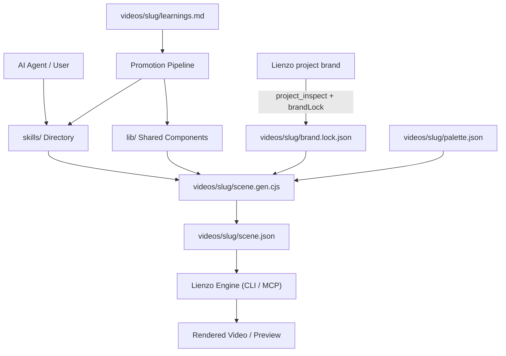

# Architecture Blueprint

This document defines the system topology, directory layout, layer boundaries, and structural patterns for Animator. AI agents must consult this document before modifying system structure or introducing new components.

---

## 🏛️ System Overview & Boundaries

### 1. Overview
Animator is a hybrid architecture composed of agent skills (`skills/`), a shared generator library (`lib/`), and self-contained video artifacts (`videos/<slug>/`). The system interacts with Lienzo as an external tool/engine: generators write compact scene JSON without depending on a running Lienzo runtime. The Lienzo project owns the brand (palette, fonts, canvas defaults, brand guide, assets) and each scene's audio; a video reads the brand through its `brand.lock.json` snapshot and records only what it changes.

### 2. Tech Stack & Dependencies
- **Runtime & Language:** Node 24+, CommonJS (`.cjs`). Zero external runtime dependencies.
- **Package Manager:** pnpm.
- **Engine / CLI:** Lienzo (`pnpm lienzo` CLI and Lienzo MCP tools).
- **Testing:** Node.js built-in test runner (`node --test`).

### 3. Layer Boundaries & Directory Map
```text
animator/
├── *.md                        # Root contracts (PRODUCT, ARCHITECTURE, ENGINEERING, DESIGN, TESTING, CHANGES, AGENTS)
├── .agents/skills/             # Spectrace skills installed from ../spectrace (pinned in skills-lock.json)
├── skills/                     # Global knowledge & agent skills
│   ├── lienzo-research/        # Factual research for videos
│   ├── lienzo-storyboard/      # Narrative, beats, and craft rules
│   ├── lienzo-art-direction/   # Visual style, palette, and review
│   └── lienzo-animate/         # Scene generator assembly (+ examples/)
├── lib/                        # Shared, palette-agnostic generator pieces
│   ├── primitives.cjs          # Flat rect / ell / path / group
│   ├── scene.cjs               # Shots, labels, closing fade
│   ├── environment.cjs         # Backdrops and particles
│   ├── objects.cjs             # Recurring objects
│   ├── motion.cjs              # Reusable keyframe tracks
│   ├── palette.cjs             # Palette check, derived tones, brand + overrides resolution
│   └── brand.cjs               # Brand snapshot (brand.lock.json) and brand fonts
├── videos/                     # Self-contained video workspaces
│   ├── _template/              # Smallest working video; copied to start a new one
│   └── <slug>/                 # Single video folder
│       ├── brief.md            # Video prompt and intent
│       ├── research.md         # Factual backing (only when the video states facts)
│       ├── brand.lock.json     # Snapshot of the Lienzo brand (written by a skill step, never by hand)
│       ├── palette.json        # Overrides and story roles only (roles & tones)
│       ├── scene.gen.cjs       # Deterministic scene generator
│       ├── scene.json          # Generated compact scene (never edited by hand)
│       └── learnings.md        # Proven findings eligible for promotion
├── tests/                      # node --test suites
│   ├── lib/                    # Unit tests for lib/
│   ├── videos/                 # Golden scenes, template run, learnings format
│   └── skills/                 # Skill docs stay in sync with lib/
└── planning/                   # Execution roadmap and spec slices
    ├── roadmap.md              # Active specs and backlog
    └── specs/                  # Atomic specification files
```

### 4. Topology & Data Flow Diagram


---

## 🔒 Structural Invariants & Boundaries

1. **Self-Contained Video Folders:** Every video in `videos/<slug>/` is a copy of `videos/_template/` with a fixed shape (`brief.md`, `brand.lock.json`, `palette.json`, `scene.gen.cjs`, `scene.json`, `learnings.md`, plus `research.md` when the video states facts).
2. **Pure Generators:** Scene generators are pure scripts that output scene JSON. They never assume Lienzo is running during generation.
3. **Brand Parameterization:** Shared pieces in `lib/` take colours from a palette argument and fonts from a `fonts` argument, and never name a brand's colour or font.
4. **Learning Promotion Seam:** Proven techniques move from `learnings.md` to `lib/` or `skills/` only after verification in a video or preview.
5. **Engineering & Testing:** For code craftsmanship (KISS, SRP, DIP) see [ENGINEERING.md](./ENGINEERING.md). For verification standards see [TESTING.md](./TESTING.md).
